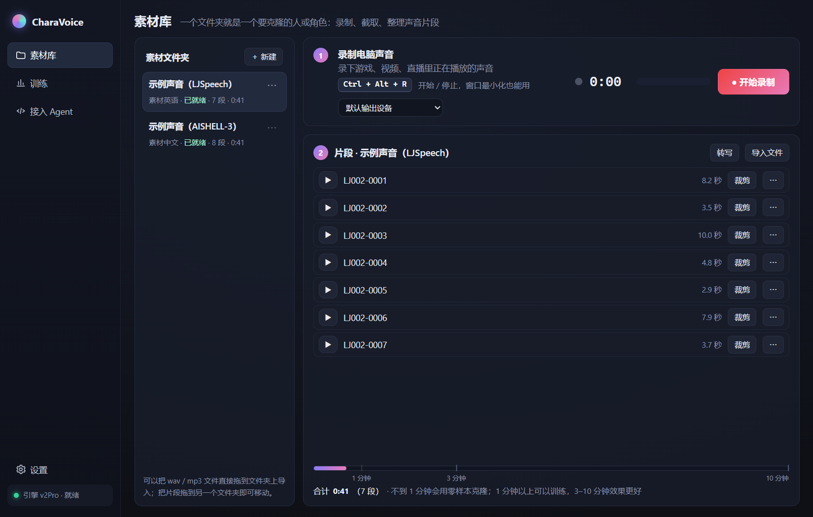
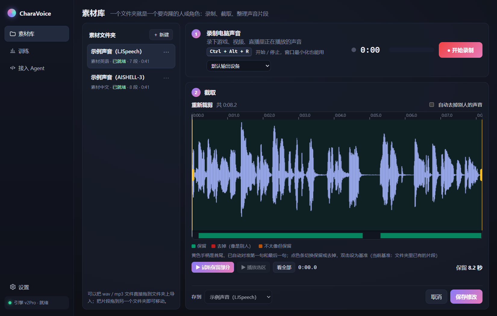
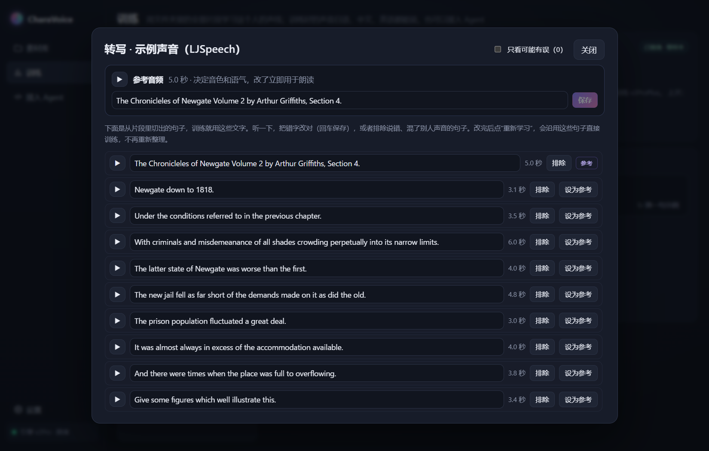
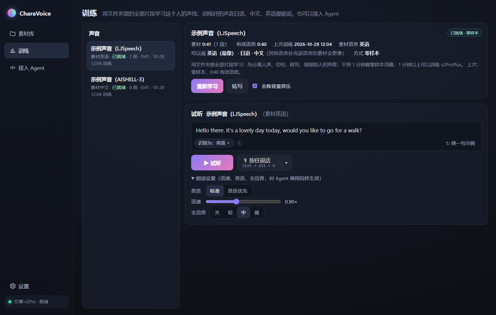
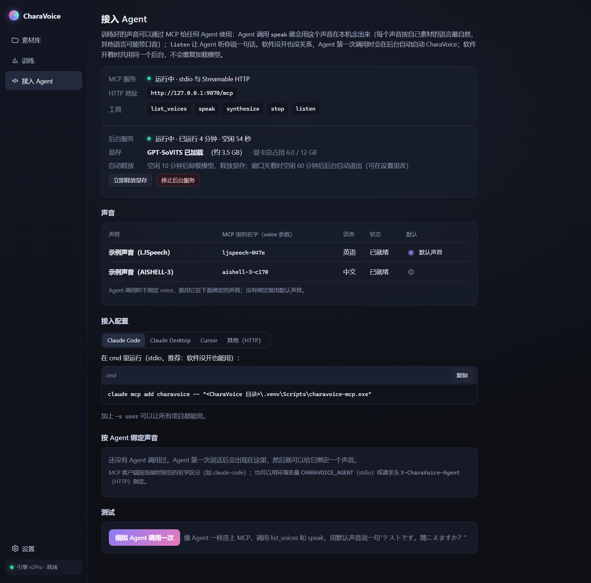

# CharaVoice

**在自己电脑上克隆角色声音，再通过 MCP 交给任何 Agent 使用。**

CharaVoice 是一个 Windows 本地桌面软件，把三件事连成一条线：整理声音素材 → 学习这个人的声线 → 让 Claude Code、Cursor 等 Agent 用这个声音说话、听你说话。录音、训练、合成全部在本机完成，不上传任何音频。



## 核心功能

| | |
| --- | --- |
| **素材库** | 按 Ctrl+Alt+R 录下电脑正在播放的声音（游戏、视频、直播），窗口最小化也能用；在波形上截取，首尾自动对准第一句和最后一句，声纹不像的段落自动标出；一个文件夹就是一个人或角色，片段可以拖动归类，也能直接拖入音频文件 |
| **转写校对** | 素材自动切成单句并转写，可能有误的句子会标出来，逐句试听、改字、排除，或设为参考音频 |
| **训练** | 一键学习整个文件夹：不到 1 分钟的素材做零样本克隆，1 分钟以上训练 GPT-SoVITS v2ProPlus；可以用干净的素材重新训练，逐轮比较后只保留最好的一版 |
| **日中英三语** | 每个文件夹有自己的素材语言（日语 / 中文 / 英语，可自动识别）；合成时按文字自动判断语种，也可以手动固定 |
| **接入 Agent（MCP）** | `list_voices`、`speak`、`synthesize`、`stop`、`listen` 五个工具；软件没开时 Agent 第一次调用会在后台自动启动服务，空闲 10 分钟自动释放显存 |
| **按住说话** | 按住 Ctrl+Alt+V（或界面上的按钮）说话，松开后识别成文字，再用选中的声音念出来 |
| **朗读** | 逐句流式播放，可调语速、音质方式和去齿音强度；对 Agent 调用同样生效 |

<table>
<tr>
<td width="50%"></td>
<td width="50%"></td>
</tr>
<tr>
<td width="50%"></td>
<td width="50%"></td>
</tr>
</table>

关闭窗口时可以缩到托盘：快捷键和 Agent 调用继续可用，点托盘图标重新打开，右键托盘图标可以释放显存、停止后台服务或退出。

## 跨语言的限制

每个声音用它素材的语言说话最像本人。让它说别的语言也可以，但音色会差一些，语调也会带素材语言的口音，比如用日语素材训练的声音说中文，听起来像日本人在说中文。软件在试听框和 MCP 返回里都会提示这一点。

实测（一个用约 2.5 分钟日语素材训练的声音，CAM++ 声纹相似度，越高越像）：日语 0.85，英语 0.77，中文 0.74。

想要某种语言自然，就给这个人准备该语言的素材，单独建一个文件夹。我们试过让母语声音先念、再用声音转换（RVC）换成目标音色：语调变地道了，但中文的相似度降到 0.52，所以没有采用。

## 硬件要求与实测性能

- Windows 10 / 11 64 位，NVIDIA 显卡。推理约占 3.5 GB 显存，训练峰值约 7 GB，建议 8 GB 以上（测试机为 12 GB）。
- 磁盘约 20 GB：GPT-SoVITS 整合包解压后约 15 GB，听写和声纹模型约 1 GB。
- 听写和转写只用 CPU。

测试机：RTX 3060 12GB、i7-13700KF、Windows 11。

| 指标 | 结果 |
| --- | --- |
| 训练过的声音，引擎已加载时开口 | 0.2–0.8 秒 |
| 合成速度 | 实时率 0.22–0.33，即比实时快 3–4 倍 |
| 引擎刚启动或刚释放显存后的第一句 | 约 15 秒（加载模型） |
| 按住说话（松开到开始念） | 0.5–1.4 秒 |
| 训练 | 10 分钟素材从开始到可用约 6 分钟 |
| 听写准确率（SenseVoice，CPU） | 中文字错误率 1.6%，英文词错误率 3.1% |

## 快速开始（从源码运行）

需要 Python 3.11、Node.js LTS、pnpm 和 Rust 工具链。在 cmd 里进入本仓库目录：

```bat
setup.bat
start.bat
```

- `setup.bat`：创建虚拟环境，下载听写模型、声纹模型和 GPT-SoVITS 官方整合包（约 11 GB，可断点续传），安装界面依赖。加 `--with-omnivoice` 另装 OmniVoice（“音质优先”朗读用，约 5 GB）。国内网络可以先 `set HF_ENDPOINT=https://hf-mirror.com`。
- `start.bat`：以开发模式打开窗口，窗口会自动启动后台服务和声音引擎。第一次要编译界面，需要几分钟；之后每次启动也会先检查编译，所以比安装版慢。
- `start-backend.bat`：只启动后台服务，不开窗口，只给 Agent 用时运行它。

源码模式下，引擎、模型和声音数据放在仓库里的 `engines\`、`models\`、`data\`，这三个目录不进版本库。

想打一个双击就能打开的安装包（NSIS，装到当前用户，不需要管理员权限）：

```bat
scripts\build-installer.bat
```

安装版的数据放在 `%LOCALAPPDATA%\io.github.rudans.charavoice`，模型和引擎在首次运行时按需下载，卸载不会删除数据。

## 使用流程

1. **素材库**：新建文件夹（一个人或一个角色），播放这个人说话的视频或游戏，按 Ctrl+Alt+R 开始录制、再按一次停止；在波形上确认首尾后保存。攒到 1 分钟以上效果更好，3–10 分钟最好。
2. **训练**：点“克隆这个声线”。软件会分离人声、切句、转写、筛掉别人的声音，然后做零样本克隆或训练（训练前会说明要占用显卡多久）。完成后可以点“转写”检查文字，改完点“重新学习”。
3. **试听**：在试听框输入文字，点“试听”，或按住“按住说话”说一句。
4. **接入 Agent**：在“接入 Agent”页复制对应客户端的配置（路径和口令已经按本机填好）。

## 接入 Agent

### Claude Code

stdio（推荐，软件没开也能用）：

```bat
claude mcp add charavoice -- "<CharaVoice 目录>\.venv\Scripts\charavoice-mcp.exe"
```

安装版把程序换成 `"<安装目录>\backend\charavoice-backend.exe" mcp`。加上 `-s user` 可以让所有项目都能用。

### Claude Desktop / Cursor

Claude Desktop 在“设置 → 开发者 → 编辑配置”里打开 `claude_desktop_config.json`；Cursor 用项目里或用户目录下的 `.cursor\mcp.json`。内容相同：

```json
{
  "mcpServers": {
    "charavoice": {
      "command": "<CharaVoice 目录>\\.venv\\Scripts\\charavoice-mcp.exe",
      "args": []
    }
  }
}
```

安装版：`"command"` 填 `charavoice-backend.exe` 的路径，`"args": ["mcp"]`。

### Streamable HTTP

需要 CharaVoice 正在运行，口令在“接入 Agent”页复制：

```bat
claude mcp add --transport http charavoice http://127.0.0.1:9870/mcp --header "Authorization: Bearer <Agent 口令>"
```

### 工具

| 工具 | 参数 | 作用 |
| --- | --- | --- |
| `list_voices` | 无 | 列出可用的声音：`voice`（传给其他工具的 id）、名字、素材语言、是否默认 |
| `speak` | `text`，可选 `voice`、`language`（ja / zh / en，默认按文字判断）、`wait` | 用这个声音在本机念出来 |
| `synthesize` | `text`，可选 `voice`、`language`、`format`（wav / mp3） | 生成音频文件（带 AI 标记和水印），返回路径和时长 |
| `stop` | 无 | 停止正在播放的语音 |
| `listen` | 可选 `timeout`（默认 15 秒）、`max_seconds`（默认 30 秒） | 打开麦克风听用户说一句，返回文字和语种 |

不传 `voice` 时，用给这个 Agent 绑定的声音，没有绑定就用默认声音。每个 Agent 按 MCP 客户端名字区分（如 `claude-code`），可以在“接入 Agent”页给它绑定声音。

语种判断：有假名按日语；只有字母按英语；没有假名的汉字句按中文，只有 1–4 个字、又没有简体字形和中文标点的短词，跟随声音的素材语言（例如日语声音念“東京”）。

**后台与显存**：后台服务在 `127.0.0.1:9870` 运行，软件和所有 Agent 共用一个，不会重复加载模型。空闲 10 分钟后卸载模型、释放显存，下次调用自动重新加载；没有窗口连着且空闲 1 小时后，后台自动退出，Agent 下次调用时再启动。两个时间都可以在“设置”里改（0 表示不自动）。

### 命令行与 HTTP

同一套功能也可以用命令行或 HTTP 调用：

```bat
.venv\Scripts\charavoice.exe speak "你好，我们开始吧。" --voice <声音id>
.venv\Scripts\charavoice.exe speak "Save this instead." --out hello.wav --no-play
.venv\Scripts\charavoice.exe listen --timeout 15
.venv\Scripts\charavoice.exe voices
```

HTTP 接口兼容 OpenAI 的 `/v1/audio/speech` 和 `/v1/audio/transcriptions`，需要请求头 `Authorization: Bearer <口令>`：

```python
from openai import OpenAI

client = OpenAI(base_url="http://127.0.0.1:9870/v1", api_key="<Agent 口令>")
client.audio.speech.create(model="<声音id>", voice="<声音id>", input="こんにちは！").write_to_file("hello.wav")
print(client.audio.transcriptions.create(model="sensevoice", file=open("hello.wav", "rb")).text)
```

完整接口文档在运行时的 `http://127.0.0.1:9870/docs`；能力清单在 `/.well-known/charavoice.json`。

## 高级功能

“设置 → 显示高级功能”会显示更细的功能：

- 声音库：用 3–10 秒录音零样本建声音，或用文字描述设计一个合成声音（OmniVoice）。
- 情绪参考、声线调节（音高、年龄感、明亮度、气声）、自然度后处理。
- 完整的素材流水线、训练向导和模型管理。
- 全局听写：在任何输入框里按 Ctrl+Alt+Space，说完后文字直接输入到光标处。

## 技术文档

实现细节见 [Docs/Implementation.html](Docs/Implementation.html)（下载后用浏览器打开）：进程结构、素材流水线、训练与逐轮选优、去齿音、流式朗读、语种判断、MCP 与后台服务。

## AI 提示

本项目在 AI 编程助手的协助下开发。想把 CharaVoice 接进自己的项目，可以把仓库代码和 `Docs/Implementation.html` 一起交给 AI，让它帮你读懂结构、写接入代码，或者按你的需要改功能。

## 负责任使用

- 只克隆**你本人的声音**，或**已获得本人明确授权的声音**。第一次使用素材库前，软件会要求确认这一点。
- 不得用克隆的声音冒充他人、诈骗、诽谤或做其他违法的事。
- 导出和接口生成的音频会写入“AI 合成”元数据，并嵌入不可听的 AudioSeal 水印（本机直接播放和流式输出不加水印）。可以用 `POST /v1/audio/watermark/detect` 检测。

## 第三方组件与模型

CharaVoice 不包含、也不分发任何第三方模型权重或引擎文件。它们由 `setup.bat` 或软件里的“模型”页从官方地址下载，各自遵循原许可：

| 组件 | 用途 | 许可 |
| --- | --- | --- |
| [GPT-SoVITS](https://github.com/RVC-Boss/GPT-SoVITS)（代码与预训练权重） | 语音合成与训练 | MIT |
| UVR5 / BS-Roformer 分离模型（随 GPT-SoVITS 整合包提供） | 人声分离 | 随整合包分发，遵循各自来源的许可 |
| [OmniVoice](https://github.com/k2-fsa/OmniVoice)（可选） | “音质优先”朗读、文字设计声音 | 代码 Apache-2.0；权重许可以模型页为准 |
| [sherpa-onnx](https://github.com/k2-fsa/sherpa-onnx) | 语音识别、VAD、声纹推理 | Apache-2.0 |
| [Silero VAD](https://github.com/snakers4/silero-vad) | 语音活动检测 | MIT |
| [SenseVoice-Small](https://github.com/FunAudioLLM/SenseVoice)（sherpa-onnx 转换版） | 中英日韩粤语音识别 | FunASR Model Open Source License v1.1（使用时需保留来源与模型名称） |
| [3D-Speaker](https://github.com/modelscope/3D-Speaker) CAM++（sherpa-onnx 转换版） | 声纹相似度 | Apache-2.0 |
| [AudioSeal](https://github.com/facebookresearch/audioseal) | 音频水印 | MIT（代码与权重） |
| [PyTorch](https://pytorch.org/)（CPU 版） | AudioSeal 推理 | BSD-3-Clause |
| [pyworld](https://github.com/JeremyCCHsu/Python-Wrapper-for-World-Vocoder)（WORLD） | 基频检测 | MIT（WORLD 为修改版 BSD） |
| [NumPy](https://numpy.org/)、[SciPy](https://scipy.org/) | 信号处理 | BSD-3-Clause |
| [pyloudnorm](https://github.com/csteinmetz1/pyloudnorm) | 响度测量 | MIT |
| [soundfile](https://github.com/bastibe/python-soundfile)、[sounddevice](https://github.com/spatialaudio/python-sounddevice) | 音频读写、麦克风与播放 | BSD-3-Clause、MIT |
| [PyAudioWPatch](https://github.com/s0d3s/PyAudioWPatch) | WASAPI 回环录音 | Apache-2.0（内含 PortAudio，MIT） |
| [FastAPI](https://fastapi.tiangolo.com/)、[python-multipart](https://github.com/Kludex/python-multipart)、[PyYAML](https://pyyaml.org/) | 后端框架 | MIT、Apache-2.0、MIT |
| [Uvicorn](https://www.uvicorn.org/)、[HTTPX](https://www.python-httpx.org/)、[websockets](https://github.com/python-websockets/websockets) | HTTP 服务与客户端 | BSD-3-Clause |
| [MCP Python SDK](https://github.com/modelcontextprotocol/python-sdk) | MCP 服务器 | MIT |
| [Tauri](https://tauri.app/) 及其插件、[Tokio](https://tokio.rs/)、[Serde](https://serde.rs/) | 桌面外壳 | MIT / Apache-2.0 |
| [Preact](https://preactjs.com/)、[Vite](https://vite.dev/) | 界面 | MIT |
| [PyInstaller](https://pyinstaller.org/)、[NSIS](https://nsis.sourceforge.io/) | 构建安装包（不随代码分发） | GPL-2.0 含 bootloader 例外（打包产物不受 GPL 约束）、zlib |

听写模型可以在设置里换成 Whisper（sherpa-onnx 转换版，MIT）。开发测试只用了公有领域的 [LJSpeech](https://keithito.com/LJ-Speech-Dataset/)，以及 [AISHELL-3](https://www.openslr.org/93/)（Apache-2.0）、[JVNV](https://sites.google.com/site/shinnosuketakamichi/research-topics/jvnv_corpus)（CC BY-SA 4.0）和 [CREMA-D](https://github.com/CheyneyComputerScience/CREMA-D)（ODbL / DbCL）片段，仓库里不包含任何音频文件。README 的截图用的是 LJSpeech 和 AISHELL-3 的零样本示例声音。

## 目录结构

```
backend/charavoice/   Python 后台（FastAPI、引擎管理、素材、训练、朗读、听写、MCP、命令行）
backend/tests/        单元测试
app/                  Tauri v2 桌面外壳（Rust）与界面（Vite + Preact + TypeScript）
Docs/                 技术文档与截图
scripts/              源码安装、后端打包、安装包构建脚本
engines/ models/ data/  本地引擎、模型与用户数据（不进版本库）
```

## 许可证

本仓库代码以 [MIT](LICENSE) 许可发布，Copyright (c) 2026 RudAns。第三方组件和模型遵循上表中各自的许可。
